# Bondflow — Bond Valuation Studio

A drag-and-drop Excel interface backed by an inspectable Python engine. Value fixed-rate, simple term-floating, and zero-coupon bullet bonds using dated market curves or explicit flat-rate assumptions.

## Try it

**Public calculator:** https://alarabuyukates-pixel.github.io/ValuationEngine/

The original ChatGPT-hosted deployment is separate: https://bondflow-valuation-lab.alarabuyukates.chatgpt.site . Its access and publication are managed independently. Changing this repository does not automatically update that deployment.

For the public site, enable **Settings → Pages → Source: GitHub Actions**, then run **Actions → Publish GitHub Pages → Run workflow → main** after code changes. GitHub collaborators with write access can update the source; publishing remains a separate workflow step.

### Run locally in PyCharm / Windows

Open this repository in PyCharm. In its Terminal:

```bat
py scripts/prepare_vendor.py
py -m http.server 8000 --directory dist
```

Visit http://localhost:8000. No pip packages are needed for the application. The preparation script downloads pinned, checksum-verified browser dependencies. The downloadable source ZIP already includes them. Use an HTTP server; opening `index.html` as a file will not load the worker correctly.

## User flow

```mermaid
flowchart LR
    A[Review or import dated market curves] --> B[Drop bond workbook]
    B --> C[Select sheet and header row]
    C --> D[Map columns, curve IDs and floating indices]
    D --> E[Run valuation]
    E --> F[Python validates each bond and selected curves]
    F --> G[Generate cash flows and settlement PV]
    G --> H[Review valuations, sources and errors]
    H --> I[Download Excel results]
```



The browser reads Excel with SheetJS. `app.js` normalizes bond columns, dates and rate units; `curves.js` manages curve imports and the public benchmark snapshot. `worker.js` starts the bundled Pyodide runtime, imports `workflow.py`, and calls `bond_engine.py` for each bond. Excel export happens in the browser. Workbooks and portfolio rows are not uploaded or stored by the application. Market-data refresh requests go to the public data provider without portfolio data. Google Fonts may be requested for styling.

## Market curves

Open **Market curves** to inspect available curve IDs, currencies, source dates, reference indices and pillars. Select **Use for discounting** or, for an index-tagged curve, **Use for index projection** to set a visible fallback in the bond mappings. Mapped workbook values take precedence over those fallbacks.

### ECB public benchmark

The application includes a dated **ECB euro-area AAA government zero curve**, derived from government-bond market data. Its ID is `ECB_EUR_AAA`. ECB spot discount factors use the quoted tenor in years in exp(−r × T), placed at calendar tenor dates for log-linear DF interpolation. The source date and retrieval time are shown in the interface; **Refresh from ECB** requests a newer observation where the provider and browser permit it. If refresh fails, the previously loaded snapshot remains available.

This is an **AAA sovereign benchmark**, not an EURIBOR projection curve or a €STR OIS discount curve. A public snapshot is not a promise of real-time data. Choose a discount curve appropriate to the instrument's valuation basis, funding and credit assumptions. Older selected curves produce explicit age warnings in results.

The public ECB feed does **not** provide the licensed EURIBOR forward curve or current contractual EURIBOR fixing. Supply those from your data provider, or use an explicitly selected flat projection assumption. Demonstration curves and sample fixings are fictional and are labelled accordingly.

### Import provider curves

Use **Download curve template**, replace its demonstration values, then load the file in **Market curves**. A bond workbook may also contain a sheet named **Curves**, which is imported alongside its bond data. Standalone `.xlsx`, `.xls`, `.csv` and normalized `.json` curve inputs are supported.

The template columns are:

| Column | Meaning |
|---|---|
| Curve ID | Unique identifier referenced by bond rows |
| Currency | Curve currency, matching the bond currency |
| As of | Market observation date, YYYY-MM-DD or an Excel date |
| Source | Provider/source description recorded in the output |
| Reference index | Required for named projection curves, e.g. `EURIBOR-3M`; blank for a discount-only curve |
| Pillar date | Date of the quoted zero rate or discount factor |
| Zero rate % | Annual zero rate; enter 3 for 3%, or use an Excel percentage cell containing 3% |
| Discount factor | Alternative to zero rate; enter exactly one quote type per pillar |
| Compounding | `continuous`, `annual` or `simple` for zero-rate conversion |
| Day count | `ACT/365F`, `ACT/360` or `30E/360` for zero-rate conversion |

Repeat consistent curve metadata on every pillar row. Inputs must be **zero rates or discount factors**, not unbootstrapped par swap rates. The tool does not bootstrap a market curve from deposit, futures or swap quotes. Curve dates, currency, index identity, positive factors and date coverage are validated. Discount factors are interpolated log-linearly; the engine never silently extrapolates beyond the last pillar.

Normalized JSON uses decimal zero rates, unlike the percentage-point Excel quote column:

```json
{
  "curves": [
    {
      "id": "MY_EURIBOR_3M",
      "currency": "EUR",
      "as_of": "2026-10-27",
      "source": "Replace with your provider",
      "reference_index": "EURIBOR-3M",
      "compounding": "continuous",
      "day_count": "ACT/365F",
      "pillars": [
        {"date": "2027-10-27", "zero_rate": 0.03},
        {"date": "2031-10-27", "zero_rate": 0.035}
      ]
    }
  ]
}
```

The numbers above are illustrative, not market quotes. Each pillar may instead contain `discount_factor` with no `zero_rate`.

## Bond workbook inputs

Use **Download template** for examples, or upload your own `.xlsx`, `.xls` or `.csv` file. Choose a worksheet and the row containing its headings. Common column names are mapped automatically; review them before running. One bond per data row. Maximum 10 MB / 5,000 bonds per run.

| Input | Requirement |
|---|---|
| Bond ID | Optional; generated if blank |
| Currency | Must match selected named curves; EURIBOR requires EUR |
| Type | `fixed`, `floating` or `zero`; `discount` and `zero-coupon` also mean zero-coupon |
| Issue, maturity, settlement | Required dates; native Excel dates or YYYY-MM-DD text |
| Notional | Required positive principal/redemption amount |
| Payments per year | Required for coupon bonds; 1, 2, 3, 4, 6 or 12 |
| Coupon day count | Required for coupon bonds; ACT/360, ACT/365F or 30E/360 |
| Fixed coupon % | Required for fixed bonds; blank or zero for zero-coupon bonds |
| Spread % | Floating annual spread, excluding the reference rate |
| Discount curve | Optional curve ID; when supplied, it overrides the flat discount rate |
| Projection curve | Floating curve ID; must identify the same reference index as the bond |
| Discount zero rate % | Required when using a flat discount override instead of a curve ID |
| Projection zero rate % | Required for floating bonds using a flat projection override |
| Index | Required for floating bonds, e.g. `EURIBOR-3M` |
| Index tenor months | Required for a custom term index; EURIBOR tenor is inferred from its name |
| Index day count | EURIBOR uses ACT/360; custom term indices can declare a supported basis |
| Current fixing % | Known current-period reference fixing, excluding spread; required for floating bonds |

A fallback applies to unmapped or blank cells. Named curve IDs always take precedence over flat rate fields. Choose a blank curve ID or `flat` to use an explicit flat override. An unknown or invalid selected curve causes an error; it does not silently fall back to a flat rate.

Missing required data produces a row error while valid bonds continue. Exclude subtotals and descriptive rows from the bond table. Merged or free-form spreadsheet layouts must first be mapped into a table; the tool cannot infer missing financial terms from arbitrary documents.

For bond rates, the default is **5 means 5%**. Choose **0.05 means 5%** if unformatted numeric cells hold decimal rates. Native Excel percentage cells and text such as `5%` are recognized automatically. Fallback bond rates always use percentage points (5 = 5%). Currency amounts remain separate; there is no FX conversion or mixed-currency PV total.

## Floating-rate index conventions

Supported EURIBOR presets are `EURIBOR-1M`, `EURIBOR-3M`, `EURIBOR-6M` and `EURIBOR-12M`. Their reference-rate accrual basis is ACT/360. The coupon payment frequency must match the index tenor: respectively 12, 4, 2 or 1 payments per year. This version does not model multiple resets within one coupon period or a reset lag.

The current unpaid period uses its supplied known fixing plus spread, including when settlement equals the period start. Future periods use a simple forward from the selected index-specific projection curve plus spread. The index's day count is used to derive the reference forward; the bond's coupon day count determines its cash interest amount. A named projection curve with a different or missing `reference_index` is rejected.

A custom term index requires an explicit tenor in months. Overnight compounded SOFR/SONIA/€STR/TLREF are outside this simple term-index model and are not treated as term indices.

## Zero-coupon discount bonds

Select type `zero`, `zero-coupon` or `discount`. The bond has **one principal payment at maturity, no coupon cash flows and zero accrued interest**. Coupon rate must be blank or zero; coupon frequency and coupon day count are not needed. Its PV is redemption principal multiplied by the discount factor from settlement to maturity. Clean and dirty values are equal.

This type describes the bond's contractual cash flows. A coupon-paying bond trading below par remains a `fixed` or `floating` bond.

## Excel output

- **Valuations:** dirty PV, accrued interest, clean PV, prices per 100, payment totals, index, selected curve IDs, source dates, sources, age warnings and status.
- **Cash Flows:** every remaining payment date, period start, reference/coupon rate, fixing or projection source, interest, principal, total payment, discount factor and payment PV.
- **Inputs:** normalized bond rows actually supplied to the engine, with source row numbers.
- **Curves:** the selected curve inputs and derived discount factors, including currency, provider, source date, reference index and quotation conventions.
- **Errors:** invalid rows with readable reasons; valid rows continue.
- **Run Info:** source filename/sheet, timestamp, rate interpretation and model assumptions.

Preview tables show up to 500 rows; the Excel export includes all results. Numeric precision is preserved even when Excel cells display two decimals.

## Financial conventions and scope

Interest = notional × coupon rate × year fraction. Principal is repaid at maturity. Dirty PV = Σ (interest + principal) × DF(payment)/DF(settlement). Clean PV = dirty PV − accrued interest. Payments on settlement are excluded; settlement must precede maturity in this workflow.

Selected curve as-of dates must be on or before settlement, with sufficient pillar coverage for all future payments. Factors are normalized to settlement; using an older market date is reported explicitly, rather than represented as a current quote. Flat overrides are continuously compounded annual zero rates on ACT/365F.

Coupon schedules run backward from maturity, preserve month-end and permit a short first stub. No holiday/business-day adjustments, ex-coupon rules, overnight compounding, amortization, caps/floors, embedded options or credit-default/recovery cash flows are modeled. Match the curve and cash-flow conventions to the bond documents before operational use.

## Source map

```text
dist/
  index.html, style.css     Interface
  app.js                   Bond import, mappings, normalized inputs and export
  curves.js                Curve library, imports and public benchmark refresh
  market-data.json         Dated public benchmark snapshot and source metadata
  worker.js                Browser Python worker
  workflow.py              Batch validation, curve selection and audit output
  bond_engine.py           Bond mathematics, schedules and curve interpolation
  vendor/                  Pinned SheetJS / Pyodide browser distributions
scripts/prepare_vendor.py  Download pinned browser dependencies
scripts/refresh_market_data.py  Refresh the official market-data snapshot
tests/                     Engine, curves, workflow and WebAssembly checks
.github/workflows/         Automated checks and manual Pages deployment
```

## Checks

```bash
PYTHONPATH=dist python -m unittest discover -s tests -v
node --check dist/app.js
node --check dist/curves.js
node --check dist/worker.js
node tests/runtime.mjs
```

On PowerShell, set `$env:PYTHONPATH="dist"` before running `python -m unittest discover -s tests -v`.

GitHub Actions **Check valuation workflow** runs checks on pushes, pull requests or manual dispatch. It tests code and does not receive uploaded portfolios. Valuation runs in the browser, independently of GitHub credentials and server storage.

Vendor notices and sources are in `THIRD_PARTY.md`. Downloadable source ZIPs exclude user workbooks and hosting identity.
