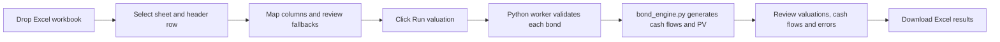

# Bondflow — Bond Valuation Studio

A drag-and-drop Excel interface backed by the same inspectable Python valuation engine used locally in PyCharm. Fixed and simple term-floating bullet bonds are supported.

## Try it

Hosted Site: https://bondflow-valuation-lab.alarabuyukates.chatgpt.site

The Sites deployment initially requires the owner's sign-in. Site access is managed separately from this public source repository. To publish a separate public copy, enable **GitHub Pages → Source: GitHub Actions** in repository Settings, then run the **Publish GitHub Pages** workflow. That workflow is manual so a code push does not change website access.

### Run locally in PyCharm / Windows

Open this repository in PyCharm. In its Terminal:

```bat
py scripts/prepare_vendor.py
py -m http.server 8000 --directory dist
```

Visit http://localhost:8000. No pip packages are needed. The preparation script downloads pinned, checksum-verified browser dependencies once. The downloadable source ZIP already includes them. Use a local HTTP server; opening index.html as a file will not load the worker correctly.

## User flow



The browser reads the workbook with SheetJS. `app.js` normalizes dates, mapped columns and rate units. `worker.js` starts the locally bundled Pyodide runtime. It imports `workflow.py`, which calls `bond_engine.py` for each bond. Excel generation happens back in the browser. Files and portfolio rows are not uploaded or stored. External Google Fonts may be requested for styling; the valuation runtime and spreadsheet library are bundled locally.

## Excel inputs

Use **Download template** for examples, or upload your own `.xlsx`, `.xls`, or `.csv` file. Choose a worksheet and the row containing its column headings. The app guesses column mappings by common names; review them before running. One bond per data row. Maximum 10 MB / 5,000 bonds per run.

| Input | Requirement |
|---|---|
| Bond ID, currency | Optional reporting fields; generated ID / unspecified currency if blank |
| Type | `fixed` or `floating`; visible default is fixed |
| Issue, maturity, settlement | Required dates; native Excel dates or YYYY-MM-DD text |
| Notional | Required positive principal amount |
| Payments per year | 1, 2, 3, 4, 6 or 12; visible fallback 2 |
| Day count | ACT/360, ACT/365F, 30E/360; visible fallback ACT/360 |
| Fixed coupon | Required for fixed bonds |
| Spread | Floating annual spread, excluding reference rate; visible fallback zero |
| Discount zero rate | Required for all bonds |
| Projection zero rate | Required for floating bonds |
| Current fixing | Required for floating bonds, excluding spread |

A fallback applies to unmapped or blank cells. Missing required data produces a row error. Do not include subtotals or descriptive rows in the bond table; these are treated as data rows and flagged if invalid. Merged or free-form layouts must be mapped into a table first. The tool cannot infer missing financial terms from arbitrary Excel documents.

Rates default to **5 means 5%**. Choose **0.05 means 5%** if your unformatted source numbers are decimal rates. Native Excel percentage cells and strings such as `5%` are recognized automatically. Fallback rates always use percentage points (5 = 5%). Explicit currency codes remain separate; there is no FX conversion or mixed-currency portfolio PV total.

## Excel output

- **Valuations:** dirty PV, accrued interest, clean PV, prices per 100, interest/principal totals and status.
- **Cash Flows:** all remaining payment dates, period starts, coupon rates, accrual fractions, interest, principal, total payment, discount factor and payment PV.
- **Inputs:** normalized rows actually supplied to the engine, with source row numbers.
- **Errors:** invalid rows with readable reasons; valid rows continue.
- **Run Info:** source filename/sheet, run timestamp, rate interpretation and model assumptions.

Preview tables show up to 500 rows; the Excel export includes every result. Export preserves full numeric precision even when cells display two decimals.

## Financial conventions

Interest = notional × coupon rate × year fraction. Principal is repaid at maturity. Dirty PV = Σ (interest + principal) × DF(payment)/DF(settlement). Clean PV = dirty PV − accrued interest. Payments on settlement are excluded; settlement must precede maturity in this workflow.

The interface uses flat continuously compounded annual discount and projection zero rates on ACT/365F. A floating period that has started requires its known reference fixing. Future coupons use a simple forward from the projection curve, plus spread. Reset date equals accrual start. Schedules run backward from maturity, preserve month-end, and allow a short first stub.

The underlying `Curve` class also supports dated discount-factor pillars with log-linear interpolation and no extrapolation. Extend the workflow to supply pillar curves if needed.

No holiday/business-day adjustments, ex-coupon rules, overnight compounded SOFR/SONIA, amortization, caps/floors, embedded options, credit-default/recovery modeling, or live market-data retrieval are included. Match assumptions to the bond documents before operational use.

## Source map

```text
dist/
  index.html, style.css    Interface
  app.js                  Excel import, mapping, normalization, results and export
  worker.js               Browser Python worker
  workflow.py             Batch validation and valuation flow
  bond_engine.py          Bond mathematics and schedule generation
  vendor/                 Pinned SheetJS 0.20.3 / Pyodide 0.27.7 distributions
scripts/prepare_vendor.py Download pinned browser runtime and Excel library
tests/                    Engine, workflow and WebAssembly runtime checks
.github/workflows/        Automated checks and optional manual Pages deployment
```

## Checks

```bash
PYTHONPATH=dist python -m unittest discover -s tests -v
node --check dist/app.js
node --check dist/worker.js
node tests/runtime.mjs
```

On PowerShell, set `$env:PYTHONPATH="dist"` before running `python -m unittest discover -s tests -v`.

GitHub Actions **Check valuation workflow** runs these checks on pushes, pull requests, or manual dispatch. It tests the application code; it does not receive uploaded portfolios. The actual user-triggered valuation flow runs in the browser, making it independent of GitHub credentials and server storage.

Vendor notices and sources are in `THIRD_PARTY.md`. Downloadable source ZIPs exclude generated workbooks and hosting identity.
